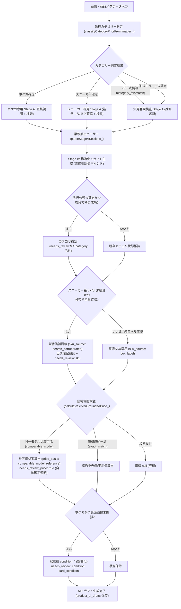
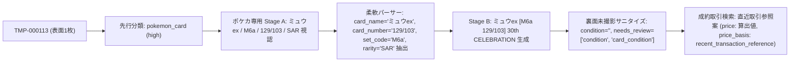
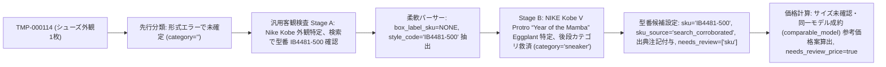

# AIドラフト推論パイプライン・検証設計・想定経路図

本ドキュメントは、AI出品ドラフト生成における推論制御パイプラインの全体像、および実画像テスト（TMP-000113、TMP-000114）における検証設計・想定経路を可視化したものです（※修正後コードの実機実測ログ取得待ち）。

GitHub Web画面やMermaid対応ビューアーで自動的にダイアグラムとして表示されます。
また、ローカルで開いてSVG/PNG画像として保存したい場合は、同フォルダの [ai_draft_inference_flow.html](./ai_draft_inference_flow.html) をブラウザで開いてください。

---

## 1. 推論パイプライン全体フロー

画像とメタデータの入力から、先行分類、Stage A、柔軟抽出、Stage B、カテゴリ救済、型番候補提示、成約価格算出、裏面未撮影サニタイズを経てドラフト保存に至る完全制御フローです。

---

## 2. TMP-000113 検証設計・想定通過経路（ポケモンカード表面1枚）

カード表面写真1枚のみの入力に対し、先行分類が高信頼度でポケカを特定、Stage Aでミュウexの各識別子を正確に読み取り、Stage Bでタイトルを構築。裏面未撮影であるため状態の断定を回避（空欄化）し、直近成約取引を参照した価格案を算出する想定設計です。

---

## 3. TMP-000114 検証設計・想定通過経路（スニーカー外観1枚）

シューズ外観1枚（箱ラベル未撮影）の入力に対し、先行分類の一時的パースエラーを後段の汎用客観検査・Stage Bで自動救済して `sneaker` を確定。Google Search で確認した型番 `IB4481-500` をモデル整合性検証（Kobe V Protro）を経て出典注記付きの候補として提示し、サイズ未確認を踏まえた同一モデル成約参考価格案を提示する想定設計です。

